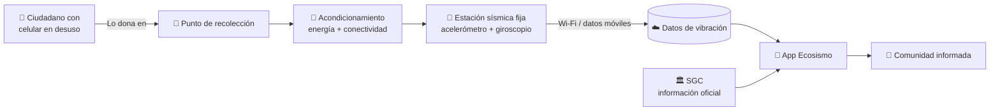

<div align="center">

# 🌎 Ecosismo

### Red Móvil Circular de Alerta Temprana

**Una segunda vida para los celulares en desuso: estaciones sísmicas de bajo costo al servicio de la comunidad.**

Solución propuesta para el **Rally Latinoamericano de Innovación 2026**


</div>

---

## 📋 Tabla de contenido

- [Descripción de la problemática](#-descripción-de-la-problemática)
- [Antecedentes](#-antecedentes)
- [La propuesta: Ecosismo](#-la-propuesta-ecosismo)
- [Funcionalidades](#-funcionalidades)
- [¿Cómo funciona?](#️-cómo-funciona)
- [Necesidades para su implementación](#-necesidades-para-su-implementación)
- [¿Por qué es una buena solución?](#-por-qué-es-una-buena-solución)
- [Diferenciador](#-diferenciador)
- [Instalación](#-instalación)
- [Estructura del repositorio](#-estructura-del-repositorio)


---

## 🧩 Descripción de la problemática

En cajones y armarios de todo el país hay **millones de celulares viejos que aún funcionan**. Aunque ya no sirven como teléfonos, conservan sensores de movimiento y orientación (**acelerómetro, giroscopio y magnetómetro**), además de **GPS y conectividad**.

Esa capacidad contrasta con una carencia frecuente en las comunidades: fenómenos como los **temblores**, las **vibraciones de una estructura** o el **desgaste de una vía** casi nunca se miden, porque los instrumentos especializados son caros y de difícil acceso.

Este reto propone aprovechar esos equipos para resolver un problema local, definiendo:

- **Qué** mide el dispositivo.
- **Dónde** se instala.
- **Cómo** se alimenta y se comunica.
- **Quién** usa sus datos para tomar decisiones.

---

## 📚 Antecedentes

El uso del celular como instrumento de medición ya cuenta con respaldo:

| Área | Trabajo | Aporte |
|---|---|---|
| Sismología | **MyShake** (Kong et al., 2016) | Demostró que los acelerómetros de teléfonos pueden conformar una red colaborativa para detectar sismos. |
| Estructuras | Figueiredo et al., 2022 | Uso del celular para medir vibraciones de puentes y reconocer posibles daños. |
| Sensórica abierta | **phyphox** y **GeoPhyphox** (RWTH Aachen University) | Registro de datos de movimiento y de campo magnético. |
| Monitoreo de vías | Mednis et al., 2011; Allouch et al., 2017; Zareei et al., 2025 | Detección de baches y estimación de la rugosidad del pavimento con acelerómetro, giroscopio y GPS. |
| Antecedente colombiano | Casas-Avellaneda & López-Parra, 2016 | Experiencia local en el uso de sensores de teléfonos. |

Adicionalmente, existen múltiples repositorios y bases de datos de libre acceso, y otros usos explorados como el seguimiento de deslizamientos, la inclinación de taludes y la vibración de maquinaria.

### 🔎 La brecha

La mayoría de estos estudios depende de **celulares que viajan dentro de vehículos de voluntarios**. Son escasos los que instalan **teléfonos en desuso como estaciones fijas**, con energía y comunicación propias.

**Ahí radica la oportunidad de esta propuesta:** darles una segunda vida a estos equipos como herramientas de medición de bajo costo al servicio de la comunidad.

---

## 💡 La propuesta: Ecosismo

**Ecosismo** es una aplicación móvil que funciona en cualquier dispositivo, **sin instalación obligatoria**, y que da una segunda vida a celulares en desuso para **acercar la información sísmica a la comunidad**. Funciona **con internet y también sin él**.

---

## ✨ Funcionalidades

- 🗺️ **Mapa de puntos de recolección y estaciones** en Armenia, Pereira, Cali, Medellín, Ibagué, Manizales, Bogotá, Bucaramanga, Quibdó y Neiva.
- 📍 **"Cómo llegar"** a cada punto mediante integración con Google Maps.
- 📊 **Historial sísmico de Colombia**: magnitud, profundidad y ubicación de los eventos.
- 🏛️ **Visor oficial del SGC** (Servicio Geológico Colombiano) integrado en la app.
- 📡 **Modo estación**: los celulares recolectados se instalan como estaciones fijas que miden vibraciones con **acelerómetro y giroscopio** y envían los datos por **Wi-Fi, datos móviles, conexión satelital y GPRS**.
- 📴 **Funcionamiento offline** para las consultas principales.

---

## ⚙️ ¿Cómo funciona?



1. **Recolección:** la app muestra en el mapa los puntos donde las personas pueden donar sus celulares viejos.
2. **Reutilización:** los equipos recolectados se instalan como estaciones fijas con energía y comunicación propias.
3. **Medición:** cada estación registra vibraciones con sus sensores internos y envía los datos.
4. **Información:** la comunidad consulta en un solo lugar el historial sísmico, el visor oficial del SGC y la red de estaciones.

---

## 🤝 Necesidades para su implementación

- 📱 **Celulares donados** por la comunidad.
- 🔌 **Energía eléctrica** para mantener las estaciones activas.
- 🏛️ **Alianzas con alcaldías** para la instalación y operación de los puntos.

---

## ✅ ¿Por qué es una buena solución?

- 💰 **Reduce el costo de medir** frente a instrumentos especializados.
- ♻️ **Reutiliza residuos electrónicos**, aportando a la economía circular.
- 📢 **Informa a la comunidad en un solo lugar.**

---

## 🌟 Diferenciador

Otras aplicaciones **solo informan** o **usan celulares en movimiento**. Ecosismo **une recolección, estaciones fijas e información oficial** en una misma plataforma.

> **Ecosismo complementa al SGC, no lo reemplaza.**

---

## 📲 Instalación

### Opción 1: APK (recomendada para probar)

1. Descarga [`Ecosismo.apk`](./Ecosismo.apk) desde este repositorio.
2. En tu dispositivo Android, permite la instalación desde orígenes desconocidos.
3. Abre el archivo y sigue las instrucciones.

### Opción 2: Compilar desde el código fuente

**Requisitos:** Android Studio y JDK 17 o superior.

```bash
git clone https://github.com/SharifGiraldoo/EcoSismo.git
cd EcoSismo
```

1. Copia el archivo de variables de entorno (opcional, solo si se usan funciones con la API de Gemini):
```bash
   cp .env.example .env
```
   y descomenta/configura `GEMINI_API_KEY`.
2. Abre el proyecto en Android Studio y sincroniza Gradle.
3. Ejecuta en un emulador o dispositivo, o compila desde terminal:
```bash
   ./gradlew assembleDebug
```

---

## 📁 Estructura del repositorio

```
EcoSismo/
├── app/                  # Código fuente de la aplicación Android
├── gradle/               # Wrapper y configuración de Gradle
├── .env.example          # Plantilla de variables de entorno
├── Ecosismo.apk          # APK listo para instalar
├── build.gradle.kts      # Configuración de build (raíz)
├── settings.gradle.kts   # Configuración de módulos
├── gradle.properties     # Propiedades de Gradle
└── metadata.json         # Metadatos del proyecto
```

---


<div align="center">

Hecho con 💚 para el **Rally Latinoamericano de Innovación 2026**

</div>
